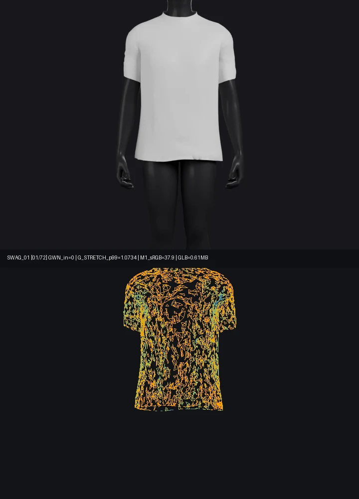
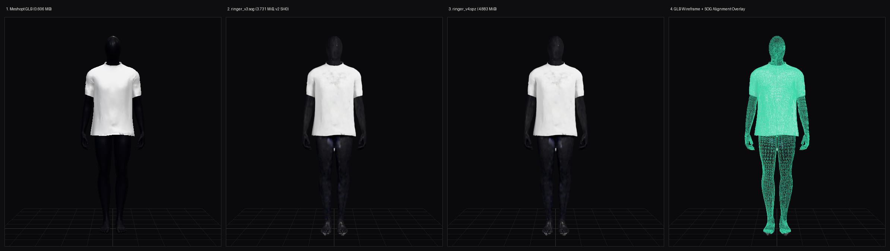

# Maximus garment physics and geometry checks

Python tools for preparing garments, draping them on a mannequin and measuring whether the result is acceptable.

## Visual Proof -> Source Code

**Status:** the single-layer ringer tee `BS-RINGER-001` passes the gates (0 intersections, stretch p99 = 1.076 on the current re-baked GLB). Multi-layer trouser + top solver stability is active R&D and does not pass yet. The gates check penetration, edge stretch and collar seating; they do not check seam closure.

### Ringer tee: GPU cloth solve and stretch view

*Front still from an earlier solve of the same garment; the printed p99, 1.0734, is that run's value.*

### Mesh and Gaussian splat alignment

*Internal WebGL2 GLB-to-3DGS diagnostic capture: bounding-box width/depth within 0.4 mm, 30 mm splat floor overhang under cleanup, SH0 blotches visible in this early splat pass.*

### Zipper macro

*Isolated macro hardware mechanism test: procedural teeth and slider on a test swatch over bare Maximus, verifying 0.08 mm closed-zone clearance against a 0.05 mm floor; not a finished jacket drape.*

| Visual | Rendered by | Built on |
|---|---|---|
| Ringer still | [`run_c0_optix_lookdev_and_reel.py`](max_garment_eng/COLAB_MEGA_SPRINT/scripts/run_c0_optix_lookdev_and_reel.py) | Solve: [`newton_cloth_template.py`](max_garment_eng/03_gpu_cloth_solver/newton_cloth_template.py) via [`run_c0_ringer_benchmark.py`](max_garment_eng/COLAB_MEGA_SPRINT/scripts/run_c0_ringer_benchmark.py). Gate maths: [`canon_geometry_kernels.py`](https://github.com/411tmnd-star/maximus-character-rig/blob/main/maximus_engine/colab_stage/canon_geometry_kernels.py) |
| QA sheet | [`qa_bs_ringer.py`](max_garment_eng/07_web_scratch_studio/qa_bs_ringer.py) | Viewer: [`spark_hybrid_viewer.js`](max_garment_eng/07_web_scratch_studio/spark_hybrid_viewer.js) |
| Zipper loop | [`m7_zipper_macro.py`](https://github.com/411tmnd-star/maximus-character-rig/blob/main/maximus_engine/colab_stage/m7_zipper_macro.py) | Geometry: [`zipper_engine.py`](https://github.com/411tmnd-star/maximus-character-rig/blob/main/maximus_engine/colab_stage/zipper_engine.py) |

The viewer depends on Three.js, `@sparkjsdev/spark`, a page and a morph module that are not included here.

## Main parts (`max_garment_eng/`)
- `01_catalog_ingest`: garment repair and preflight checks
- `02_alignment_and_collar`: collar alignment and rest-length adapters
- `03_gpu_cloth_solver`: Newton/Warp cloth template, libuipc IPC benchmark, Blender fallback
- `04_clearance_gates`: edge-stretch, float64 winding-number penetration and collar gates
- `05_morph_and_export`: size morphs and compact GLB export
- `06_splat_binding_and_relight`: experimental Gaussian-splat binding and packing
- `07_web_scratch_studio`: splat viewer and its QA script

Other folders hold earlier garment-engine, collar, rhinestone placement, avatar and clearance-diagnostic work.

## Status
In progress. The gates are written as pass/fail checks (for example stretch p99 <= 1.08). One of nine catalogue garments, the ringer tee, has passed all of them (p99 1.076, 0 penetrations). Multi-layer GPU draping is still being tuned.

## About this repository
Published from a larger private workspace. Third-party code, large binaries and generated data are left out, so some scripts and tests need inputs that are not included here. Paths under `~/Desktop/...` are the author's defaults; change them for your machine.
